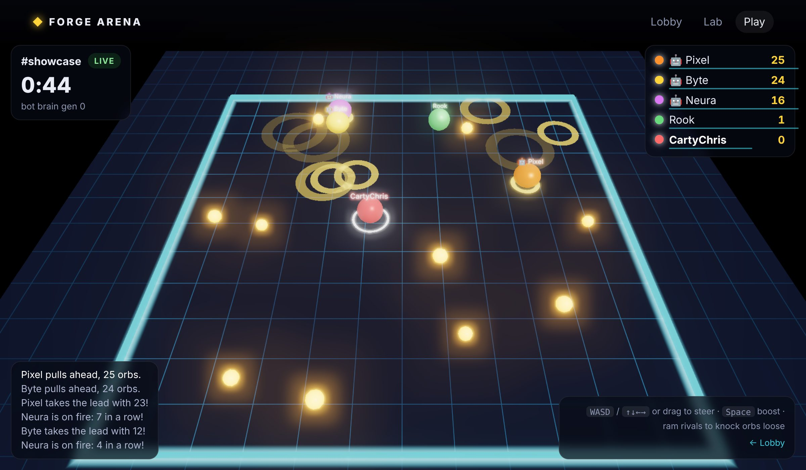
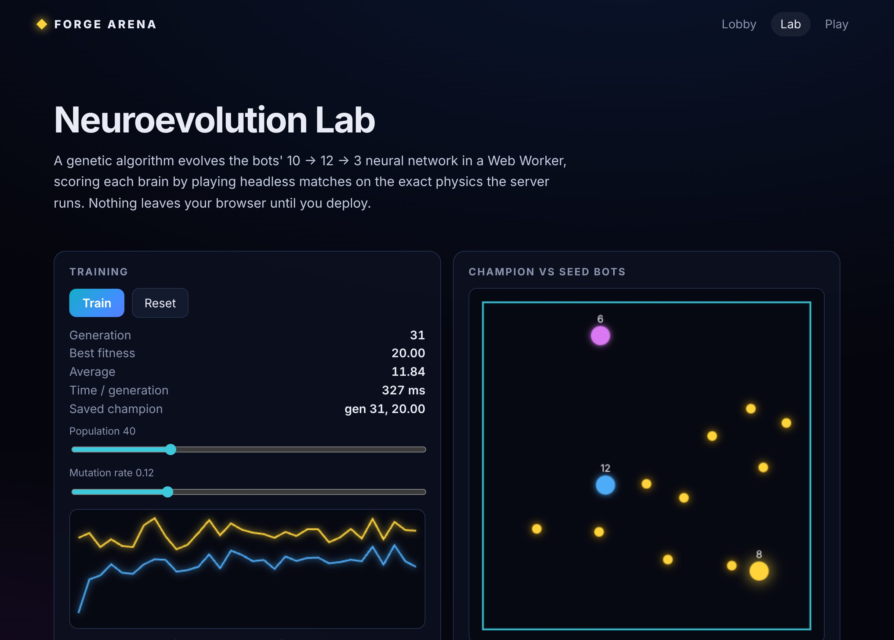
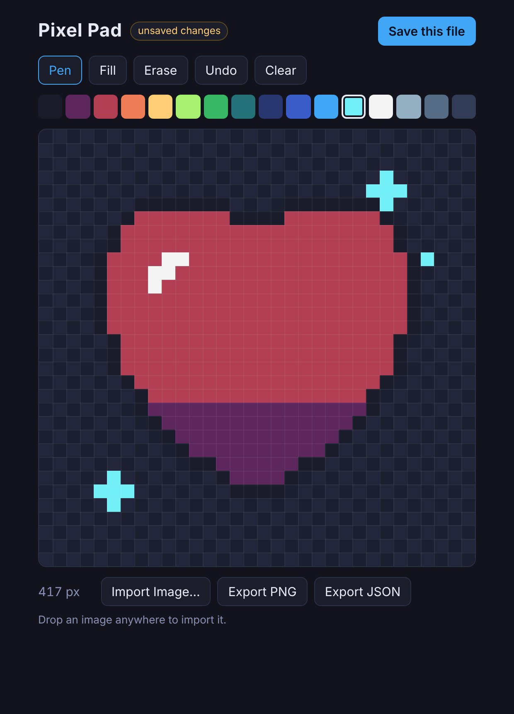
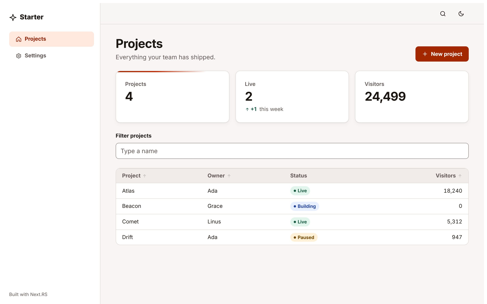
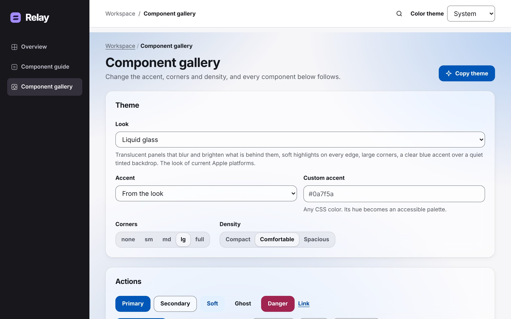

# Next.RS

*by [@CartyChris](https://github.com/CartyChris)*

**A Rust-native React framework in one binary.** File-based routing, streaming SSR, server data loaders and API routes, like Next.js, with no Node.js at build time or at runtime. The same app builds three ways:

```bash
forge build                        # SSR server: forge start
forge build --target static        # prerendered site for any static host
forge build --target single-html   # one self-contained index.html that works offline, even from file://
```

The `forge` binary (~25 MB) contains the bundler ([Rolldown](https://rolldown.rs) + [Oxc](https://oxc.rs), in-process), a JavaScript engine for server rendering ([QuickJS](https://github.com/quickjs-ng/quickjs)), and an HTTP server ([Axum](https://github.com/tokio-rs/axum)). npm is used only to install packages.

```tsx
// app/page.tsx
import { useState } from "react";

export const meta = { title: "Hello" };

export default function Page() {
  const [n, setN] = useState(0);
  return <button onClick={() => setN(n + 1)}>Clicked {n} times</button>;
}
```

`.tsx`, `.jsx`, `.ts` and `.js` are all first-class (TypeScript wins when both exist). Pages can also skip React entirely: export `render()` and/or `mount(el)`, which suits canvas games and small tools.

## Proof of life: Forge Arena

[`examples/arena`](examples/arena) is a real-time multiplayer 3D arena where people and neural-network bots race for glowing orbs, built entirely on Next.RS:



- **Authoritative game rooms** are WebSocket routes. Every socket for `/api/room/<name>` runs on the same JS worker, so the room's memory *is* the game state; 20 snapshots a second fan out to players in Rust.
- **The bots learn in your browser.** The lab evolves their 10 → 12 → 3 neural network with a genetic algorithm in a Web Worker, on the exact physics the server runs. Deploy a brain and every live room hot-swaps it within 2 seconds.
- **The lobby** is streamed SSR with a loader, then kept live over a lobby socket. A caster comments on the action, with an optional LLM caster through `forge:ai`.
- **`forge build --target single-html`** turns the whole thing (React, three.js, bloom, the game, the training worker) into one **257 kB** file that plays offline against bots, with zero network requests.



```bash
forge new arena --template arena && cd arena && npm install && forge dev
```

## One file, anywhere

A single HTML file is the most portable app there is: email it, open it from a USB stick, keep it for ten years. Next.RS treats it as a first-class target.

**Small by default.** Single-file builds compress themselves when it pays: the script is deflated and stored as base-122 text (7 bits per byte, where base64 manages 6), then inflated by the browser and run as the same ES module.

| Example | Plain | Shipped |
|---|---|---|
| React (TSX, layouts, loaders, streaming) | 235 kB | **85 kB** |
| three.js game | 504 kB | **145 kB** |
| Forge Arena (React + three.js + a worker) | 802 kB | **257 kB** |

**Any page, packed.** `forge pack` turns HTML you already have, or a single component, into one offline file:

```bash
forge pack demo.html            # a page that loads from CDNs → demo.packed.html, no network needed
forge pack Counter.tsx          # one React component → Counter.html, with React, icons and Tailwind inside
forge pack Counter.tsx --watch  # repack on save, live reload at :3000
```

CDN URLs (unpkg, jsDelivr, esm.sh, Skypack, jspm) are fetched as verified npm packages; import maps and module scripts are bundled; scripts, styles, fonts and images are inlined (large ones compressed, still running in place); `<script type="text/babel">` is compiled ahead of time and the ~3 MB Babel runtime dropped. Packages are checked against their registry integrity, and nothing is fetched from private networks. Measured on the [test fixtures](tests/fixtures/pack): a three.js import-map demo (1.6 kB page) becomes a 133 kB offline file, a React + Babel page 61 kB, and an artifact-style `Counter.tsx` (React 19, lucide-react, Tailwind) 165 kB, each loading with every network request blocked.

**Files that save themselves.** `forge:file` gives single files a document model: `useDocument()` starts from the state saved in the file, and Ctrl/Cmd+S writes a copy of the app with the new state inside. Drop, open and export files with one call each. [`examples/pixel`](examples/pixel) is a 90 kB pixel-art editor built this way:



**Develop against the real thing.** `forge dev --target single-html` rebuilds the actual file on every save and live-reloads it, so hash routing, embedded data and inlined assets behave exactly as shipped.

## Quick start

```bash
cargo install --git https://github.com/CartyChris/Next.RS
```

```bash
forge new my-app --template starter   # or: react, jsx, vanilla, three, models, models-rust, models-mixed, ai, pixel, arena
```

```bash
cd my-app && npm install && forge dev
```

`forge dev` rebuilds on save (the React example: ~0.2 s including restarting the JS workers) and reloads the browser. Build and security errors appear as an in-browser overlay.

## Rust-generated 3D models in one HTML file

Choose `models` for the Three.js editor (WebGPU with WebGL2 fallback),
`models-rust` for a Rust/WASM WebGL2 editor without Three.js, or `models-mixed`
to switch renderers on the same geometry. All three run the same Rust generator,
open mesh JSON from Python or other producers, and export binary glTF.
The standalone HTML embeds its dependencies. The same projects also build for
static hosting or a Next.RS server.

```bash
rustup target add wasm32-unknown-unknown
forge new model-lab --template models
cd model-lab && npm ci
forge build --target single-html
```

`dist/index.html` contains the compiled WASM, renderer, application and styles.
Configured Rust crates build automatically through `build.wasm`, and imports such
as `forge:wasm/mesh` become embedded data in single-file output. The `forge:mesh`
adapter validates the ABI and returns owned typed arrays. Only projects that opt
into Rust compilation need Cargo and the WASM target.

The example runs through Chromium and WebKit browser checks. WebKit coverage is
distinct from physical iPhone testing; use an HTTPS page for phone distribution.
Existing GLSL games retain their compatible renderer and gain reusable touch,
gamepad and adaptive-resolution helpers. See [the models guide](docs/MODELS.md)
and [Model Lab](examples/model-lab).

## An interface kit in the binary

`import { … } from "forge:ui"` gives an app 59 typed, accessible React components with nothing to install: layout, forms, dialogs, menus, a sortable table, toasts, a command palette, an app shell, and HUD parts for games. `forge new my-app --template starter` begins here:



One `Theme` sets the look for the whole app. Eight named looks ship with it, and each is a starting point: every prop next to `preset` overrides it.

```tsx
<Theme preset="liquid-glass">                                  // translucent, blurred panels
<Theme preset="graphite" theme="dark">                         // dense and monochrome
<Theme preset="forge" accent="#0a7f5a" radius="full">          // your brand color, pill corners
```



- **One hue drives the palette.** Pass any CSS color as `accent`; lightness is fixed per role in OKLCH, so text keeps AA contrast for every color, in light and dark.
- **Looks are labeled for people and agents.** `forge themes frosted apple glass` (or the MCP theme tool) answers with the preset and its settings.
- **Custom parts follow along.** Everything is driven by `--forge-ui-*` CSS variables, so your own components pick up the accent, corners, density and glass.
- **Checked the way it ships.** The showcase runs under axe on the server, static and single-file targets, at 320px and desktop widths.

Components and looks: [docs/FORGE_UI.md](docs/FORGE_UI.md). Rules for a result that does not look generated: [docs/DESIGN.md](docs/DESIGN.md). Every component, live: [Relay](examples/ui-showcase) at `/components`.

## Built for coding agents

An agent should be able to build with a framework it has never seen. Next.RS carries what it needs:

- **`forge docs <words>`** searches the documentation inside the binary; no network, no stale training data.
- **`forge mcp`** is a Model Context Protocol server (stdio, or `--http` for network clients such as n8n): search docs, look up a component's props, find a look, then create, check, test, build and pack projects.
- **`forge new`** writes an `AGENTS.md` with the conventions and pitfalls into every project, and a `.mcp.json` that registers the server.
- **`forge check`** validates routes, runs the security scan on server and client code, and writes type declarations, so one command plus `tsc` says whether a change is sound.
- **`forge test`** and **`forge run`** execute tests and scripts in the same engine and sandbox as production server code.
- **Errors say what to do next**, with `file:line:col`.

```json
{ "mcpServers": { "forge": { "command": "forge", "args": ["mcp"] } } }
```

## What you get

**Routing and data**
- `app/` directory routing: `[param]`, `[...catchAll]`, `(groups)`, `_private` folders, nested `layout`s, `not-found`
- `loader.ts` beside a page: server-only data, `notFound()`, `redirect()`, `staticParams()` for prerendering
- `route.ts` API routes: one export per HTTP method, plain values become JSON, any `Response` (including streams) passes through
- `ctx.signal` everywhere: a closed tab or a timeout aborts loaders, API handlers, React renders and outbound `fetch`
- Client-side navigation with route-level code splitting, hover/focus prefetch, history or hash routing

**Realtime**
- `export const socket = { open, message, close }` turns a route into a WebSocket endpoint
- Rooms for free: all sockets and HTTP requests for one path share a JS worker, so module state is consistent
- Topic pub/sub (`ws.publish`, `publish()` from any server code) fanned out in Rust across workers; rate limits, slow-client protection, pings
- `forge:realtime` in the browser: reconnecting JSON socket and a `useSocket` hook

**Rendering**
- Streaming SSR with real React Suspense (fallbacks first, content as it resolves); crawlers get complete HTML
- `export const ssr = false` for client-only pages (WebGL, `window` at module scope)
- `export const revalidate = 60`: page cache, stale-while-revalidate, `invalidate("/path")` from server code
- `meta` export for title, description, Open Graph, theme color

**Built-in modules**
- `forge:navigation`, `forge:data`: `Link`, `useRouter`, `useData`, …
- `forge:cache`: TTL + tag cache and key-value store shared by all server workers
- `forge:store`: `usePersistentState`, localStorage-backed (save games, settings), works from `file://`
- `forge:ai`: `chat()` and a tool-calling `runAgent()` over OpenAI-compatible, Anthropic, Gemini and Ollama protocols (normalized streaming events, assembled tool arguments, usage, abort), plus a mock provider for offline work
- `forge:realtime`: sockets and pub/sub (above)
- `forge:game`: fixed-timestep loop, keyboard/multipointer input, independent joysticks/action buttons, gamepads, adaptive DPR and async renderer fallback
- `forge:mesh`: validated Rust mesh ABI, copied typed arrays, geometry bounds and lifecycle cleanup; `forge:wasm/<name>` imports compiled Rust libraries
- `forge:file`: open/save/drop files; self-saving single files (`useDocument`, `saveSelf`)
- `forge:ui`: components, themes and looks (above)
- `forge:n8n`: call n8n workflows with `trigger()`, receive their calls with `webhook()`; works with any webhook tool
- `forge:test`: `test`, `describe`, `expect` for `forge test`

**Assets and workers**: CSS imports; images, audio, fonts, 3D models, `.wasm`, `.onnx` as hashed URLs (data URLs in single-file builds); shaders and prompts (`.glsl .frag .vert .wgsl .md .prompt`) as strings; `new Worker(new URL("./x.worker.ts", import.meta.url))` bundles a worker, which also works offline from a single HTML file.

**Dev loop**: rebuild on save, live reload, an in-page overlay for build errors and uncaught client errors, an access log, and `Server-Timing` on every response.

**Secure by default**
- Build-time AST scan of app code: `eval`, `new Function`, remote imports and Forge internals are rejected with `file:line:col`
- Strict CSP with a per-response nonce
- Server code sees only allowlisted env vars and can `fetch` only allowlisted hosts (redirects re-checked)
- Per-worker heap cap, CPU budget and request timeout; a runaway worker is replaced without taking the server down
- Production errors are redacted; build outputs are hash-verified (`capsule.json`) before `forge start`

## Examples

| Template | Shows |
|---|---|
| [`starter`](examples/starter) | application shell on `forge:ui`: sidebar, theme switch, table from a loader, settings form, command palette, API route, a test |
| [`react`](examples/react) | TSX, layouts, loaders + `staticParams`, Suspense streaming, API route, 404 |
| [`jsx`](examples/jsx) | plain JSX clicker with persistent state, built as one HTML file |
| [`vanilla`](examples/vanilla) | no framework, zero dependencies: `render()` + `mount()`, loaders, API |
| [`three`](examples/three-game) | three.js game: fixed-step loop, input, GLSL imports; 145 kB single file |
| [`models`](examples/model-lab) | **Model Lab**: Rust/WASM procedural models, WebGPU/WebGL2 viewer, touch orbit, wireframe/normals and GLB export in one offline file |
| `models-rust` | Same editor with a Rust/WASM renderer and a small WebGL2 browser adapter |
| `models-mixed` | Switch between the Three.js and Rust backends while keeping the current model |
| [`pixel`](examples/pixel) | **Pixel Pad**: pixel-art editor in one 90 kB file that saves itself, imports dropped images, exports PNG |
| [`ai`](examples/ai-chat) | streaming chat UI; proxies any OpenAI-compatible API (OpenAI, Ollama, LM Studio, vLLM, …) or echoes offline |
| [`arena`](examples/arena) | **Forge Arena**: multiplayer socket rooms, neural bots trained in a worker, SSR lobby, 257 kB offline build |

[Relay](examples/ui-showcase) is the `forge:ui` showcase: a dashboard plus a gallery of every component with live theme controls.

## Performance

Measured on a 4-core cloud VM, release build, 32 concurrent connections:

| | Throughput | Avg latency |
|---|---|---|
| React SSR page (layout + page) | ~1,250 req/s | 25 ms |
| React SSR page with loader | ~1,360 req/s | 23 ms |
| Vanilla SSR page | ~12,500 req/s | 2 ms |
| `/_forge/data` (loader JSON) | ~13,000 req/s | 2 ms |
| JSON API route | ~7,200 req/s | 4 ms |

| Build (release) | Time |
|---|---|
| React app, server target (incl. Brotli-11 precompression) | 0.52 s |
| React app, single-html | 0.15 s |
| three.js game, single-html | 0.16 s |
| Vanilla app | 0.03 s |

QuickJS is an interpreter, so JS-heavy React SSR is several times slower than a V8/JIT runtime would be. It buys a small, fast-to-build, strictly sandboxable engine, and everything that is not React rendering (routing, static files, data, streaming proxies, caching) runs in Rust. For hot pages, `revalidate` serves cached HTML at static-file speed. A V8 backend is on the [roadmap](docs/ROADMAP.md). Details: [ARCHITECTURE.md](docs/ARCHITECTURE.md#why-quickjs-instead-of-v8).

## Documentation

- [Guide](docs/GUIDE.md): routing, pages, layouts, loaders, APIs, targets, modules, configuration, security, deployment
- [Agent guide](docs/AGENT_GUIDE.md): the one-page version for coding agents; also `forge docs --read agents`
- [Rust models and mobile 3D](docs/MODELS.md): Cargo/WASM integration, mesh ABI, renderer fallback, touch/gamepad controls and browser verification
- [Forge UI](docs/FORGE_UI.md) and [design rules](docs/DESIGN.md): components, looks, tokens, and what good looks like
- [Architecture](docs/ARCHITECTURE.md): how the build, runtime and server fit together, and why
- [Status](docs/STATUS.md): what is implemented, mapped against the original milestone plan
- [Roadmap](docs/ROADMAP.md): what is next, as tickets
- [Handoff](handoff/README.md): the original design package this repository started from

## Developing Next.RS

```bash
cargo test                                      # unit + integration tests (no npm needed)
```

```bash
rustup target add wasm32-unknown-unknown
for e in react jsx three-game ai-chat arena pixel starter ui-showcase model-lab; do (cd examples/$e && npm ci); done
cargo test --features e2e                       # React / JSX / three.js / AI examples
node --test tests/js/*.test.mjs                 # game runtime + real Rust/WASM mesh boundary
cargo test --locked --manifest-path examples/model-lab/rust/mesh/Cargo.toml
```

```bash
cargo build --release
node tests/browser/smoke.mjs target/release/forge
node tests/browser/models.mjs target/release/forge
```

Use an already installed Playwright package with its Chromium and WebKit runtimes.
CI installs browser tooling outside the repository; do not add a local Playwright
copy under `tests/browser/node_modules`. Browser checks require real graphics
contexts. See `.github/workflows/ci.yml` for the reproducible setup.

```bash
node tests/browser/forge-ui.mjs target/release/forge   # forge:ui showcase on all three targets, with axe
```

```text
src/
  main.rs            CLI: new, dev, build, start, check, run, test, docs, themes, mcp, pack
  config.rs          forge.config.json, targets, .env
  routes.rs          app/ scanner and matcher
  build/             analyze (Oxc), wasm (Cargo), generated (codegen), bundle (Rolldown), html, manifest
  runtime/           QuickJS worker pool, host ops, embedded JS runtime (js/)
  server/            Axum handler, static files, dev server
  render.rs          request protocol and page documents
  scaffold.rs        templates (embedded from examples/)
  mcp.rs             MCP server, built-in docs search, component and theme lookup
  pack/              forge pack: pages and component files into one offline file
packages/forge-ui/   source of the built-in forge:ui module
examples/            templates, the model editor, the UI showcase, and test fixtures
tests/               Rust integration, JavaScript runtime and browser tests
```

## License

MIT © [CartyChris](https://github.com/CartyChris)
