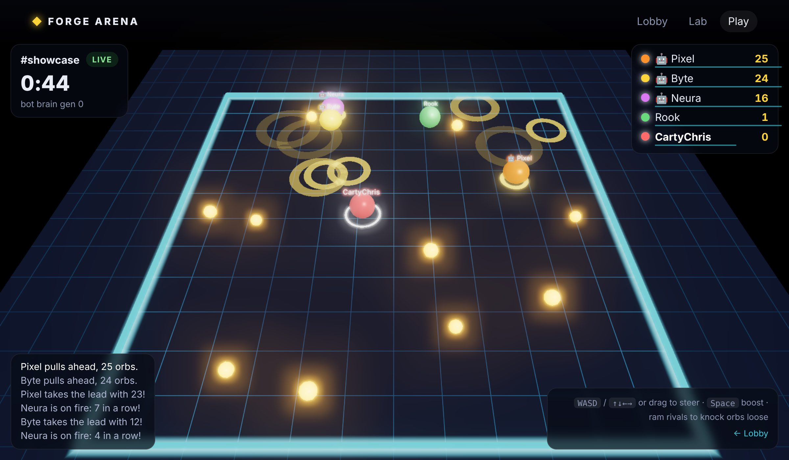
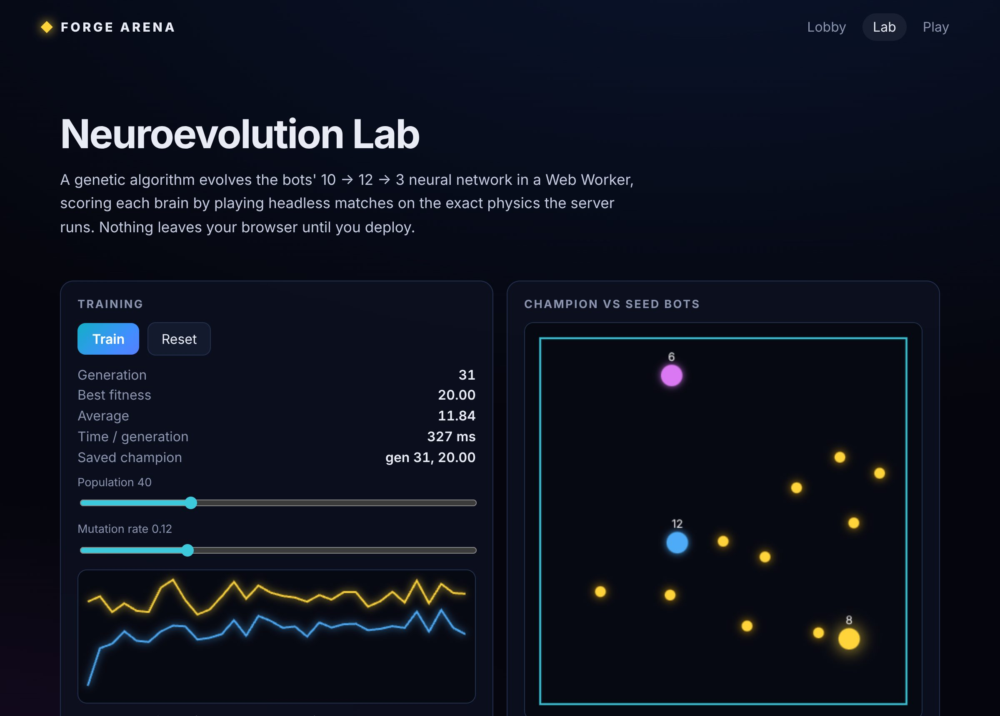

# Next.RS

*by [@CartyChris](https://github.com/CartyChris)*

**A Rust-native React framework in one binary.** File-based routing, streaming SSR, server data loaders and API routes, like Next.js, with no Node.js at build time or at runtime. The same app builds three ways:

```bash
forge build                        # SSR server: forge start
forge build --target static        # prerendered site for any static host
forge build --target single-html   # one self-contained index.html that works offline, even from file://
```

The `forge` binary (~25 MB) contains the bundler ([Rolldown](https://rolldown.rs) + [Oxc](https://oxc.rs), in-process), a JavaScript engine for server rendering ([QuickJS](https://github.com/quickjs-ng/quickjs)), and an HTTP server ([Axum](https://github.com/tokio-rs/axum)). npm is used only to install packages.

```tsx
// app/page.tsx
import { useState } from "react";

export const meta = { title: "Hello" };

export default function Page() {
  const [n, setN] = useState(0);
  return <button onClick={() => setN(n + 1)}>Clicked {n} times</button>;
}
```

`.tsx`, `.jsx`, `.ts` and `.js` are all first-class (TypeScript wins when both exist). Pages can also skip React entirely: export `render()` and/or `mount(el)`, which suits canvas games and small tools.

## Proof of life: Forge Arena

[`examples/arena`](examples/arena) is a real-time multiplayer 3D arena where people and neural-network bots race for glowing orbs, built entirely on Next.RS:



- **Authoritative game rooms** are WebSocket routes. Every socket for `/api/room/<name>` runs on the same JS worker, so the room's memory *is* the game state; 20 snapshots a second fan out to players in Rust.
- **The bots learn in your browser.** The lab evolves their 10 → 12 → 3 neural network with a genetic algorithm in a Web Worker, on the exact physics the server runs. Deploy a brain and every live room hot-swaps it within 2 seconds.
- **The lobby** is streamed SSR with a loader, then kept live over a lobby socket. A caster comments on the action, with an optional LLM caster through `forge:ai`.
- **`forge build --target single-html`** turns the whole thing (React, three.js, bloom, the game, the training worker) into one **290 kB** file that plays offline against bots, with zero network requests.



```bash
forge new arena --template arena && cd arena && npm install && forge dev
```

## Quick start

```bash
cargo install --git https://github.com/CartyChris/Next.RS
```

```bash
forge new my-app --template react   # or: jsx, vanilla, three, ai
```

```bash
cd my-app && npm install && forge dev
```

`forge dev` rebuilds on save (the React example: ~0.2 s including restarting the JS workers) and reloads the browser. Build and security errors appear as an in-browser overlay.

## What you get

**Routing and data**
- `app/` directory routing: `[param]`, `[...catchAll]`, `(groups)`, `_private` folders, nested `layout`s, `not-found`
- `loader.ts` beside a page: server-only data, `notFound()`, `redirect()`, `staticParams()` for prerendering
- `route.ts` API routes: one export per HTTP method, plain values become JSON, any `Response` (including streams) passes through
- `ctx.signal` everywhere: a closed tab or a timeout aborts loaders, API handlers, React renders and outbound `fetch`
- Client-side navigation with route-level code splitting, hover/focus prefetch, history or hash routing

**Realtime**
- `export const socket = { open, message, close }` turns a route into a WebSocket endpoint
- Rooms for free: all sockets and HTTP requests for one path share a JS worker, so module state is consistent
- Topic pub/sub (`ws.publish`, `publish()` from any server code) fanned out in Rust across workers; rate limits, slow-client protection, pings
- `forge:realtime` in the browser: reconnecting JSON socket and a `useSocket` hook

**Rendering**
- Streaming SSR with real React Suspense (fallbacks first, content as it resolves); crawlers get complete HTML
- `export const ssr = false` for client-only pages (WebGL, `window` at module scope)
- `export const revalidate = 60`: page cache, stale-while-revalidate, `invalidate("/path")` from server code
- `meta` export for title, description, Open Graph, theme color

**Built-in modules**
- `forge:navigation`, `forge:data`: `Link`, `useRouter`, `useData`, …
- `forge:cache`: TTL + tag cache and key-value store shared by all server workers
- `forge:store`: `usePersistentState`, localStorage-backed (save games, settings), works from `file://`
- `forge:ai`: `chat()` and a tool-calling `runAgent()` over OpenAI-compatible, Anthropic, Gemini and Ollama protocols (normalized streaming events, assembled tool arguments, usage, abort), plus a mock provider for offline work
- `forge:realtime`: sockets and pub/sub (above)
- `forge:game`: fixed-timestep loop, keyboard/pointer input, DPR-aware canvas sizing

**Assets and workers**: CSS imports; images, audio, fonts, 3D models, `.wasm`, `.onnx` as hashed URLs (data URLs in single-file builds); shaders and prompts (`.glsl .frag .vert .wgsl .md .prompt`) as strings; `new Worker(new URL("./x.worker.ts", import.meta.url))` bundles a worker, which also works offline from a single HTML file.

**Dev loop**: rebuild on save, live reload, an in-page overlay for build errors and uncaught client errors, an access log, and `Server-Timing` on every response.

**Secure by default**
- Build-time AST scan of app code: `eval`, `new Function`, remote imports and Forge internals are rejected with `file:line:col`
- Strict CSP with a per-response nonce
- Server code sees only allowlisted env vars and can `fetch` only allowlisted hosts (redirects re-checked)
- Per-worker heap cap, CPU budget and request timeout; a runaway worker is replaced without taking the server down
- Production errors are redacted; build outputs are hash-verified (`capsule.json`) before `forge start`

## Examples

| Template | Shows |
|---|---|
| [`react`](examples/react) | TSX, layouts, loaders + `staticParams`, Suspense streaming, API route, 404 |
| [`jsx`](examples/jsx) | plain JSX clicker with persistent state, built as one HTML file |
| [`vanilla`](examples/vanilla) | no framework, zero dependencies: `render()` + `mount()`, loaders, API |
| [`three`](examples/three-game) | three.js game: fixed-step loop, input, GLSL imports; 165 kB single file |
| [`ai`](examples/ai-chat) | streaming chat UI; proxies any OpenAI-compatible API (OpenAI, Ollama, LM Studio, vLLM, …) or echoes offline |
| [`arena`](examples/arena) | **Forge Arena**: multiplayer socket rooms, neural bots trained in a worker, SSR lobby, 290 kB offline build |

## Performance

Measured on a 4-core cloud VM, release build, 32 concurrent connections:

| | Throughput | Avg latency |
|---|---|---|
| React SSR page (layout + page) | ~1,250 req/s | 25 ms |
| React SSR page with loader | ~1,360 req/s | 23 ms |
| Vanilla SSR page | ~12,500 req/s | 2 ms |
| `/_forge/data` (loader JSON) | ~13,000 req/s | 2 ms |
| JSON API route | ~7,200 req/s | 4 ms |

| Build (release) | Time |
|---|---|
| React app, server target (incl. Brotli-11 precompression) | 0.52 s |
| React app, single-html | 0.15 s |
| three.js game, single-html | 0.16 s |
| Vanilla app | 0.03 s |

QuickJS is an interpreter, so JS-heavy React SSR is several times slower than a V8/JIT runtime would be. It buys a small, fast-to-build, strictly sandboxable engine, and everything that is not React rendering (routing, static files, data, streaming proxies, caching) runs in Rust. For hot pages, `revalidate` serves cached HTML at static-file speed. A V8 backend is on the [roadmap](docs/ROADMAP.md). Details: [ARCHITECTURE.md](docs/ARCHITECTURE.md#why-quickjs-instead-of-v8).

## Documentation

- [Guide](docs/GUIDE.md): routing, pages, layouts, loaders, APIs, targets, modules, configuration, security, deployment
- [Architecture](docs/ARCHITECTURE.md): how the build, runtime and server fit together, and why
- [Status](docs/STATUS.md): what is implemented, mapped against the original milestone plan
- [Roadmap](docs/ROADMAP.md): what is next, as tickets
- [Handoff](handoff/README.md): the original design package this repository started from

## Developing Next.RS

```bash
cargo test                                      # unit + integration tests (no npm needed)
```

```bash
for e in react jsx three-game ai-chat; do (cd examples/$e && npm install); done
cargo test --features e2e                       # React / JSX / three.js / AI examples
```

```bash
cargo build --release && (cd tests/browser && npm install && npx playwright install chromium && node smoke.mjs ../../target/release/forge)
```

```text
src/
  main.rs            CLI: new, dev, build, start, check
  config.rs          forge.config.json, targets, .env
  routes.rs          app/ scanner and matcher
  build/             analyze (Oxc), generated (codegen), bundle (Rolldown), html, manifest
  runtime/           QuickJS worker pool, host ops, embedded JS runtime (js/)
  server/            Axum handler, static files, dev server
  render.rs          request protocol and page documents
  scaffold.rs        templates (embedded from examples/)
examples/            five apps, also the `forge new` templates and test fixtures
tests/               Rust integration tests and the browser smoke test
```

## License

MIT © [CartyChris](https://github.com/CartyChris)
